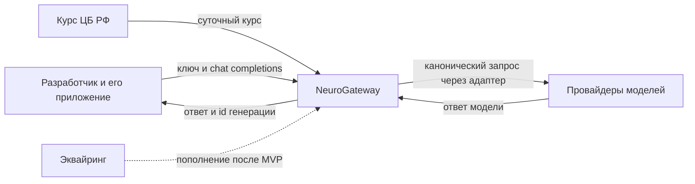

# Контекстная диаграмма

Клиент и его приложение снаружи. Шлюз внутри. Провайдеры, курс и платежи снаружи. На Release 0.5 платёжный контур нарисован пунктиром: вызов есть в целевой системе, в первом срезе вместо него заглушка пополнения.

Стрелка к эквайрингу не входит в объём Release 0.5. Стрелки к провайдеру и к курсу входят: без провайдера нет ответа, без курса нельзя зафиксировать рублёвую проводку для валютной себестоимости.
